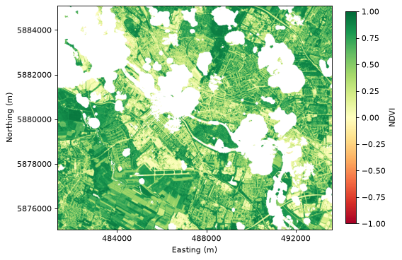

# Climate Data Entrepreneurial Club (CDEC)

[](https://pypi.org/project/cdec)
[](https://pypi.org/project/cdec)

`cdec` downloads satellite data for a study area from the
[Copernicus Data Space](https://dataspace.copernicus.eu/) and draws it. You call one function, you get one
(Cloud Optimized) GeoTIFF that you can open with `rasterio` or QGIS. The package is written for teaching:
one function per data type, short readable code, and defaults that work.

It covers fifteen data types: the vegetation, water, moisture and snow indices NDVI, EVI, NDWI, NDMI and NDSI
(Sentinel-2), true-colour and false-colour images (urban, infrared and SWIR; Sentinel-2), the Sentinel-2 scene
classification, NDVI from the Landsat mosaic, land surface temperature (Sentinel-3), soil water index, elevation
and land cover.

## Installation

Python 3.10 or newer is required.

```console
pip install cdec
```

## Quick start

You need a free [Copernicus Data Space account](https://dataspace.copernicus.eu/). The first download opens a login
(device code), later downloads reuse the stored token.

```python
from cdec import download_ndvi, plot_ndvi

spatial_extent = {"west": 8.721771, "south": 53.025027, "east": 8.904419, "north": 53.114965}
temporal_extent = ["2024-06-01", "2024-07-01"]

path = download_ndvi("data/ndvi_bremen.tif", spatial_extent, temporal_extent)
plot_ndvi(path)
```

`download_ndvi` returns the path of the file, and `plot_ndvi` draws it:



*Bremen, June 2024. White: no data. Contains modified Copernicus Sentinel data 2024.*

To learn what a function writes (bands, data type, unit, no-data value, pixel size) and what its options do, ask Python:

```python
help(download_ndvi)
```

## Data types

One function for each data type. Every `download_*` function has a `plot_*` function with the matching name
(`download_ndvi` and `plot_ndvi`), and a long name that says the same in words
(`download_normalized_difference_vegetation_index`). The long name and the short name are the same function.

The column *Temporal extent* is the period that the collection covers in openEO (the `t` dimension of its data cube).
Choose your `temporal_extent` inside it, for example `["2024-06-01", "2024-07-01"]` for June 2024 (the end date is not
included). Elevation and land cover are static maps and need no period.

| Data | Download function | Source | Pixel size | Temporal extent |
| --- | --- | --- | --- | --- |
| NDVI, vegetation | `download_ndvi` | Sentinel-2 | 10 m | 2015-06-27 until present |
| EVI, vegetation | `download_evi` | Sentinel-2 | 10 m | 2015-06-27 until present |
| NDWI, water | `download_ndwi` | Sentinel-2 | 10 m | 2015-06-27 until present |
| NDMI, moisture of plants | `download_ndmi` | Sentinel-2 | 10 m | 2015-06-27 until present |
| NDSI, snow and ice | `download_ndsi` | Sentinel-2 | 10 m | 2015-06-27 until present |
| True-colour image | `download_tci` | Sentinel-2 | 10 m | 2015-06-27 until present |
| False-colour image, urban | `download_urban` | Sentinel-2 | 10 m | 2015-06-27 until present |
| False-colour image, infrared (vegetation) | `download_infrared` | Sentinel-2 | 10 m | 2015-06-27 until present |
| False-colour image, short-wave infrared | `download_swir` | Sentinel-2 | 10 m | 2015-06-27 until present |
| Scene classification (cloud, water, ...) | `download_scl` | Sentinel-2 | 10 m | 2015-06-27 until present |
| NDVI, long time series | `download_landsat` | Landsat mosaic | 30 m | 1997-01-01 to 2025-12-31 |
| Land surface temperature | `download_lst` | Sentinel-3 | 1 km | 2016-04-17 until present |
| Soil water index | `download_swi` | Copernicus Land Monitoring Service | 1 km | 2025-07-12 until present |
| Elevation | `download_dem` | Copernicus DEM | 30 m | 2010-12-12 to 2015-01-16 (static) |
| Land cover | `download_land_cover` | ESA WorldCover 2021 | 10 m | 2021 (static) |

## Build and test

The tests, the documentation and the package are run and built with [Hatch](https://hatch.pypa.io/):

```console
hatch run test          # all tests that work offline
hatch run docs:build    # the documentation in English and German
hatch run types:check   # type check with mypy
hatch build             # the package (sdist and wheel) in the folder dist/
```

Tests that download real data need a Copernicus login: `hatch run test-live`.

## License

`cdec` is distributed under the terms of the [MIT](https://spdx.org/licenses/MIT.html) license.
